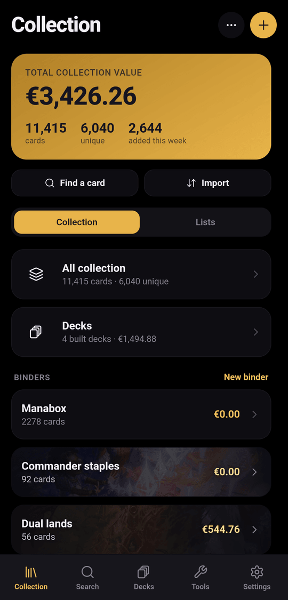
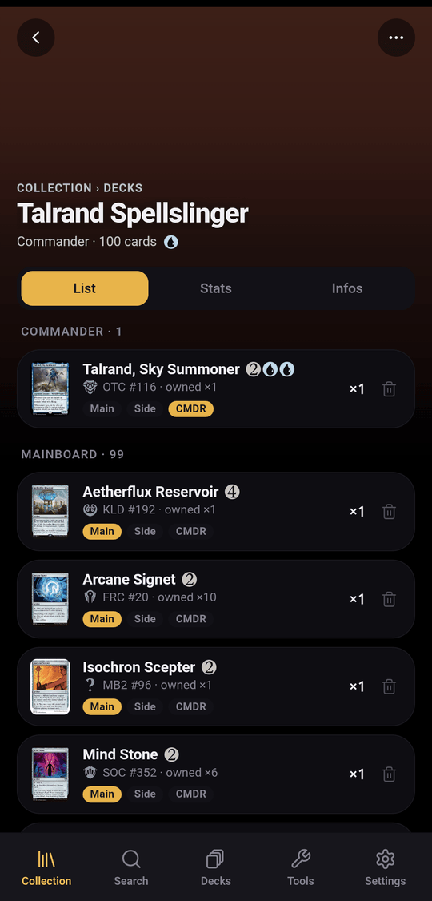
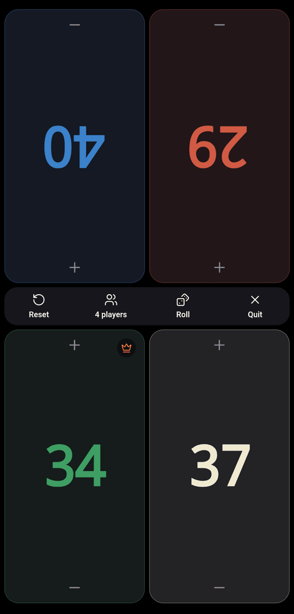

# spellcache

**Your Magic: The Gathering collection, on your own server.**

**Documentation: [spellcache.github.io/spellcache](https://spellcache.github.io/spellcache/)**

spellcache is a self-hosted, mobile-first web app to manage a card collection:
inventory, binders, deck building and the life of a deck from plan to built,
collection value tracking, card trading, and a few table tools (life counter,
first-player pick, deck playtest). A collection can be shared between several
accounts, and decks and binders can be shared publicly by link.

Card data, images and prices come from a local mirror of
[Scryfall](https://scryfall.com)'s bulk data, refreshed every night. Your data
stays in your database; no Scryfall API call is made while you browse.

## Screenshots

| Collection | Deck | Life counter |
|---|---|---|
|  |  |  |

## Features

- **Collection**: every copy with its finish, condition and language; binders
  and lists; fast search and filters over the whole catalogue.
- **Decks**: build from your collection or from cards you don't own yet,
  Commander legality, assemble a deck from owned copies, dismantle it back.
- **Value**: daily prices (TCGplayer in $ or Cardmarket in €), per collection,
  binder and deck.
- **Trading**: a step-by-step wizard, in person or live with another account of
  your server. Pick cards from your binders, import the other side's list, add
  cash and notes, compare values, apply the trade to your collection, and
  export it to send to the other person.
- **Sharing**: collections shared between accounts with Owner, Contributor and
  Guest roles; public links for decks and binders.
- **Mobile first, desktop too**: installable as an app (PWA), with a sidebar and
  a preview pane on large screens.
- **Android app**: an APK attached to every
  [release](https://github.com/spellcache/spellcache/releases), which opens your
  own server. It adds a card scanner: point the camera at a pile of cards, review
  them, and add them all at once. Text is read on the phone; no image leaves it.
- **Sign-in without passwords**: a one-time link or code by email.

## Quick start (self-hosting)

Requirements: a Linux server with Docker, a domain with an HTTPS reverse proxy, and a
[Resend](https://resend.com) account for sign-in emails.

```bash
curl -fsSL https://get.spellcache.com | sudo sh
```

The [installer](install.sh) downloads the files of the latest release into
`/srv/spellcache`, asks for your URL, the administrator's email and the Resend
key, starts the containers and imports the card catalogue (twenty minutes to an
hour). Then put your HTTPS reverse proxy in front of `127.0.0.1:3000`. Running
it again updates to the latest release.

The complete guide (manual installation, reverse proxy, backups, restore,
updates) is in the
**[self-hosting documentation](https://spellcache.github.io/spellcache/self-hosting/installation/)**.

## Documentation

The documentation is published at
**[spellcache.github.io/spellcache](https://spellcache.github.io/spellcache/)**,
from the Markdown sources in [`docs/`](docs/):

- [Quick start](https://spellcache.github.io/spellcache/quick-start/) and
  [self-hosting](https://spellcache.github.io/spellcache/self-hosting/installation/):
  installation, email, reverse proxy, scheduled tasks, backup and restore,
  updates, troubleshooting
- [User guide](https://spellcache.github.io/spellcache/guide/collection/):
  collection, importing, decks, trading, sharing, table tools, mobile,
  administration
- [Configuration reference](https://spellcache.github.io/spellcache/reference/configuration/)
  and [FAQ](https://spellcache.github.io/spellcache/reference/faq/)
- [Development](docs/development.md) and
  [architecture](https://spellcache.github.io/spellcache/contributing/architecture/)
- Contributing, code of conduct and security policy: see the
  [spellcache organisation](https://github.com/spellcache) defaults

## Development

```bash
cp .env.example .env          # then set AUTH_SECRET (openssl rand -base64 32)
docker compose up -d postgres redis
pnpm install && pnpm db:migrate && pnpm import:bulk
pnpm dev
```

Details in [docs/development.md](docs/development.md). Code comments are
written in French; identifiers, the UI and the documentation are in English.

## License

The source code is released under the [MIT License](LICENSE). Third-party
material is listed in [NOTICE](NOTICE).

## Legal

spellcache is unofficial Fan Content permitted under the
[Fan Content Policy](https://company.wizards.com/en/legal/fancontentpolicy).
Not approved/endorsed by Wizards. Portions of the materials used are property
of Wizards of the Coast. ©Wizards of the Coast LLC.

Card data, images and prices are provided by [Scryfall](https://scryfall.com)
and are subject to Scryfall's terms; spellcache is not affiliated with Scryfall.
Mana and set symbols are not part of this repository: they are downloaded from
Scryfall at setup time.
