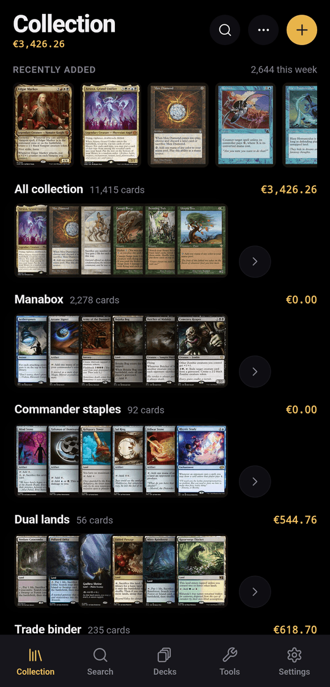

## Sign in

spellcache has no passwords.

1. Enter your **Email address** and tap **Send magic link**.
2. The email holds a 6-digit code and a sign-in link, both valid for 10
   minutes. Type the code (it signs you in on the sixth digit), or open the
   link on the same device.
3. At your first sign-in, choose a username: 3 to 20 characters, lowercase
   letters, numbers, `-` or `_`.

In the installed app or the Android app, use the code: the link opens in the
browser. An account must be invited by an administrator unless sign-ups are
open on your server (see [Administration](../administration/)).

## Find your way around

On a phone, the tab bar holds **Collection**, **Search**, **Decks**, **Tools**
(once a tool is on) and **Settings**. From 900 px wide, a sidebar replaces it,
and from 1280 px a card preview pane can replace the card sheet
(**Settings › Appearance › Card preview pane**).

## The Collection tab

The top of the screen shows the **total collection value**, its change over
the last 7 days when available, and three counters: cards, unique cards and
cards added this week.

Below, **Collection** lists **All collection**, your **Decks** that are built,
and your **Binders**; **Lists** shows your lists. Two layouts exist, chosen in
**Settings › Appearance › Collection home**:

- **Compact**: one row per binder or list.
- **Shelves**: one horizontal shelf of cards per binder, list and built decks,
  with a **Recently added** track on top.

## Binders and lists

| | Binder | List |
|---|---|---|
| Holds | Cards you own | Cards you don't own: a wishlist, a trade target, a set to complete |
| Counts in the collection value | Yes | No, only in the list's own total |
| Created from | `···` › **New binder** | `···` › **New list** |

A card you own is either loose in the collection or in one binder. Deleting a
binder never deletes its cards: they go back loose in the collection.

A binder's `···` menu offers **Rename**, **Binder look**, **Share** (see
[Sharing](../sharing/)), **Export list** and **Delete binder**.

## Add a card

1. Tap **+**, or tap a result in the **Search** tab.
2. Type at least two letters of the name, pick the card, then the printing.
   **Edition** lets you switch printing later.
3. Set the **Quantity**, the **Finish** (Non-foil or Foil), the **Condition**
   (NM, LP, MP, HP, DMG) and the **Language** (`en` by default).
4. Tap **Add to collection**, **Add to binder** or **Add to list**, depending on
   where you started.

Cards added from the Collection home or from Search go loose into the
collection. To add many cards at once, [import a list](../importing/).

## Edit, move and remove

Tap a card to open its sheet, then **Edit** to change quantity, condition,
foil, edition, language, notes or **Binder** (**No binder** puts it back loose
in the collection). Bringing the quantity down to 0 removes the card; an
**Undo** button stays on screen for a few seconds.

To act on several cards, long-press a row (on desktop, Ctrl-click or
Shift-click). The action bar offers:

- **Binder**: move the selection to a binder;
- **To deck**: move it to a deck that is still being planned;
- **Edit**: set condition, finish, quantity or language on every selected card;
- **Delete**.

Each bulk action can be undone right after.

## Search, filter and sort

The search field at the top of every card list searches by name within that
list. **Filters** narrows by colour (including, exactly, at most), type,
rarity, finish, condition, set, binder and price; active filters show as chips
you can remove one by one. **Sort & group** sorts by value, name, quantity,
set and number, rarity, mana value or date added, and groups by set, colour,
type or rarity.

Three densities are available: **Rows**, **Compact** and **Grid**. The default
comes from **Settings › Appearance › Card list density**; changing it in a list
only affects that view.

## Binder look

`···` › **Binder look** gives a binder a **Colour** (six tints) or **Card art**:
any card of the catalogue, owned or not, with the artist credited. Decks can
also use their commander's art. **Settings › Appearance › Artwork and tints**
hides every look at once without deleting them.

## Prices and value

Prices come from Scryfall and are refreshed every night. Each account picks one
market in **Settings › Preferences**:

| Price source | Currency |
|---|---|
| **Cardmarket trend** (default) | EUR (€) |
| **TCGplayer market** | USD ($) |

**Currency** and **Price source** are the same setting seen from two sides:
spellcache never converts between currencies. Values appear on the Collection
home, on every binder, list and deck, and on public pages.
**Settings › Appearance › Display prices** shows or hides prices on Grid tiles.
