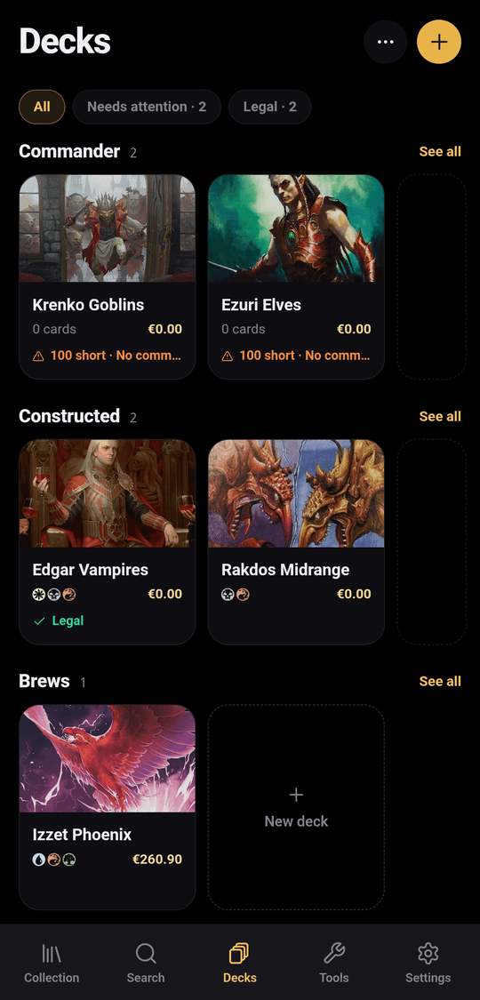
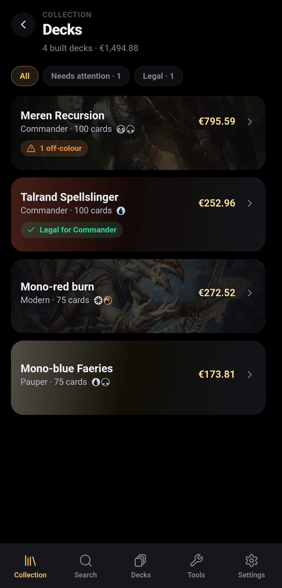

A deck in spellcache follows the life of a real deck: you plan it, gather the
cards, build it, and one day take it apart.

| Stage | Where it lives | What it means |
|---|---|---|
| **Plan** | Decks tab | A list of cards, owned or not. Nothing moves in your collection. |
| **Assemble** | Decks tab | You are gathering the cards: spellcache shows what you own and what is missing. |
| **Built** | Collection › Decks | The deck reserves the copies it uses; they are no longer free for other decks or trades. |
| **Dismantled** | Decks tab | The cards went back to the collection, or left it. The list stays. |

A built deck can be moved back to Assemble, and a dismantled deck restarted as
a plan.

## The Decks tab

Decks that are not built sit on folder shelves; **Unsorted** holds those without
a folder. Folders have one level only (`···` › **New folder**). Long-press a
deck to **Edit**, **Move to**, **Duplicate** or **Delete** it; deleting a folder
keeps its decks.

Filter chips show **All**, **Needs attention**, **Legal** and **No format**.

## Create a deck

Tap **+**, give the deck a name and a format (or **No format**), and tap
**Create**. To start from an existing list, use **Import a deck** (see
[Importing](../importing/#import-a-deck)).

## Build the list

**Add cards** opens a drawer that stays open while you add. Pick the zone first:
**Main**, **Side**, or **Cmdr** for Commander decks. Each result shows how many
copies you own and how many are already in the deck. **Owned only** limits the
search to your collection; **Legal in deck colours** hides cards outside the
commander's colour identity. You can add cards you don't own.

In the **List** tab, each card has a zone selector (**Main**, **Side**,
**CMDR**) and a remove button. **Stats** shows the card count, average mana
value, lands versus nonlands, the mana curve and the colour distribution.
**Infos** shows how many cards you already own, what is left to buy and its
cost, the deck's value and your notes.

### Formats and legality

Commander decks are checked: exactly 100 cards, singleton except basic lands,
no banned or illegal card, a commander, and every card within its colour
identity. The status reads, for example, **Legal for Commander**, or lists what
is wrong ("36 short · 2 duplicates · 1 off-colour").

The other formats (Modern, Standard, Pioneer, Legacy, Vintage, Pauper) are
recorded on the deck but not checked. The commander zone holds one card.

## Assemble

**Assemble** opens a sheet with three counts: **owned**, **missing** and **to
buy**.

- **Use from built decks** borrows missing cards from your other built decks;
  **Ignore cards in collection** plans as if you owned nothing.
- In **Missing**, tick the cards you just bought, or **Mark all as bought**.
- **Export missing** sends the missing cards to Card Kingdom, Cardmarket (wants
  list), TCGplayer (mass entry), Moxfield or Archidekt, or as plain text or CSV.

**Assemble with N cards** builds the deck. Cards ticked as bought are added to
your collection; cards you already own stay where they are, reserved by the
deck.

## Dismantle

From a built deck, `···` › **Dismantle**, then choose:

- **Return the cards to the collection**: they go back loose (or into the binder
  you pick), and the deck stays as a list;
- **Remove the cards from the collection**: for a deck you sold or traded away.

## Share and playtest

`···` › **Share** publishes a read-only page of the deck (see
[Sharing](../sharing/#public-links)). **Playtest** draws opening hands and plays
the first turns (see [Table tools](../table-tools/#playtest)).
