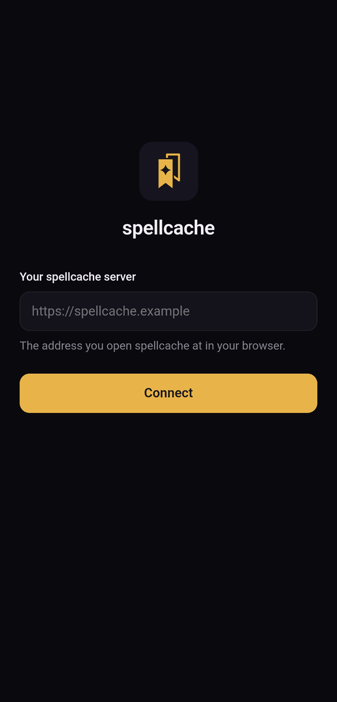

spellcache is built for phones first. There are two ways to have it on your
home screen; both open your own server and always run its current version.

| | Installed web app (PWA) | Android app (APK) |
|---|---|---|
| Android | Yes | Yes, Android 7.0 or later |
| iPhone, iPad | Yes | No |
| Install from | Your browser | [GitHub releases](https://github.com/spellcache/spellcache/releases) |
| Updates | With the server | With the server; the APK itself rarely changes |

Neither works offline: spellcache always needs a connection to your server.

## Installed web app

Open your spellcache address in the browser, then use the browser's own install
entry:

- **Chrome on Android**: menu › **Add to Home screen** (or **Install app**).
- **Safari on iPhone**: share button › **Add to Home Screen**.
- **Chrome or Edge on desktop**: the install icon in the address bar.

The app opens in its own window, without the browser's toolbar.

## Android app

1. Download `spellcache-<version>.apk` from the latest
   [release](https://github.com/spellcache/spellcache/releases). A
   `.sha256` file next to it lets you check the download.
2. Open it on the phone. Android asks you to allow installs from the browser or
   file manager you used: allow it for this install.
3. On first launch, enter **Your spellcache server**, the address you open
   spellcache at in your browser (e.g. `https://spellcache.example.com`), and
   tap **Connect**.

The server must be reachable over HTTPS with a certificate Android trusts.
Plain HTTP and self-signed certificates are refused. If the app cannot reach
the server, check the address and that the server answers in a browser.

Later launches open your server directly. To change server, press the system
**Back** button from the first page of your server: it returns to the server
screen. Links to other sites open in your browser.

## Signing in on a phone

The sign-in email holds both a link and a 6-digit code. In the installed web
app and in the Android app, type the **code**: the link opens in the browser,
not in the app. See [Collection](../collection/#sign-in) for the sign-in steps.
