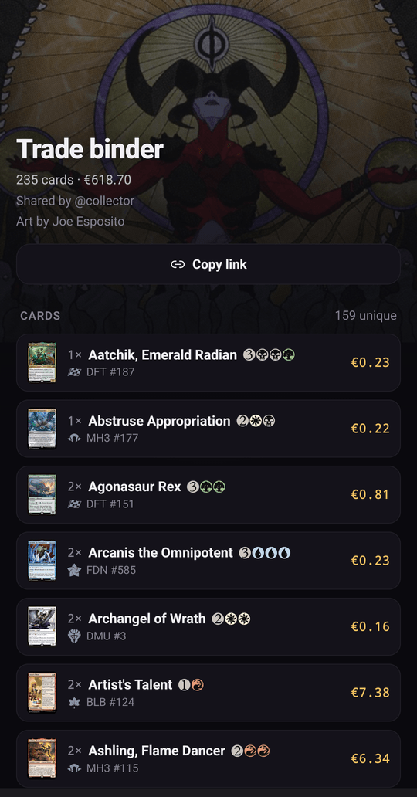

## Shared collections

A collection is a shared space, not a single account's property. Every account
starts with its own; you can create more (**Settings › New collection**) and
switch between those you belong to (**Settings › Switch to**).

Each collection has one **Owner** and any number of members:

| Role | Can |
|---|---|
| **Owner** | Everything, plus manage members, rename, publish links, transfer or delete the collection |
| **Contributor** | Add, edit and remove cards, binders and decks |
| **Guest** | See everything, change nothing |

### Add a member

As the Owner, open **Settings › Collection › Add a member**:

1. Type a **username** (existing accounts are suggested) or an **email**.
2. Choose **Contributor** (default) or **Guest**.
3. Tap **Add**, or **Invite** for an email address.

Inviting an email with no account creates one and sends it a sign-in link, but
only when the Owner is an administrator or sign-ups are open on the server.
Otherwise, ask an administrator to invite the person first.

Tap a member to change their role or remove them. **Danger zone** holds **Leave
collection**, **Transfer ownership** (you stay on as a Contributor) and **Delete
collection**.

## Public links

Decks and binders can be published by link. Only the collection's Owner can do
it: `···` › **Share** › **Make it public**, then **Copy link**. The address
looks like `https://your-server/s/<id>`.

Anyone with the link, without an account, sees:

- the name and the cover;
- the card list with quantities and prices, and the total value in the owner's
  currency;
- who shared it, and the deck's status for a deck.

The rest of your collection, the copies you own elsewhere and the cards you
are still missing stay private. **Remove share** takes the page down at once:
the link then answers "not found".

:::note
Public pages must stay reachable without signing in. Scryfall's terms do not
allow card data behind a login, so a server should not put an access filter in
front of `/s/` (see [Reverse proxy](../../self-hosting/reverse-proxy/#public-share-pages)).
:::
