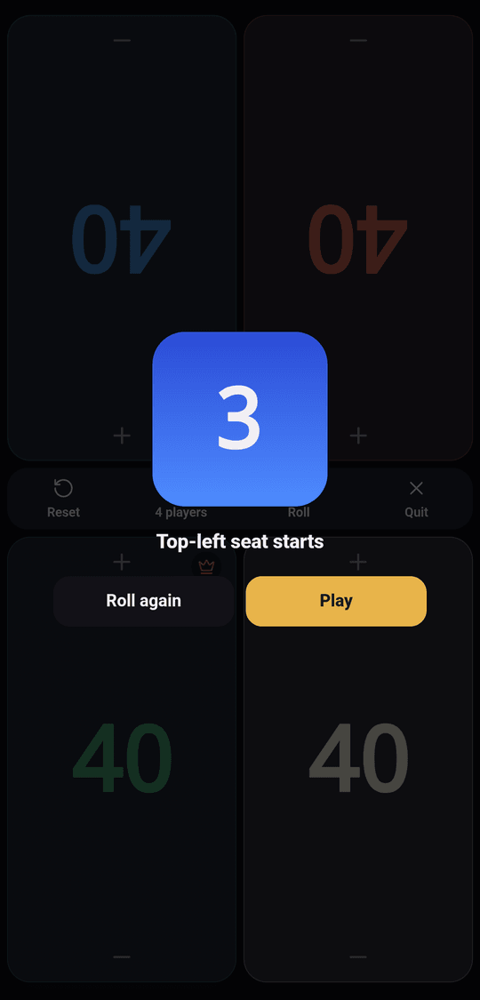
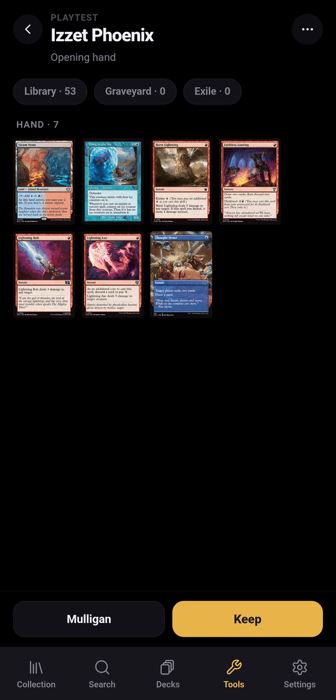

Tools are off by default. Turn them on in **Settings › Tools**; the **Tools**
tab appears in the tab bar as soon as one of them is on.

| Tool | What it does |
|---|---|
| **Life tracker** | Life totals for up to six players, with a first-player pick |
| **Playtest** | Draw opening hands, mulligan and play the first turns of a deck |
| **Trading mode** | See [Trading](../trading/) |

## Life tracker

**Tools › Life tracker** opens the setup screen:

- **Players**: 2 to 6.
- **Starting life**: 20, 30, 40, or **Other** for any whole number.
- **Roll for first player**: picks a seat at random when the game starts.
- **Keep the screen awake**: stops the phone from going to sleep during the
  game.

**Start game** opens a full-screen, dark table. The pads of the top row are
upside down so the players across the table can read them. Tap **+** or **−**
on a pad, or hold it to change the total faster. A skull appears at 0 or below,
and a crown marks the first player.

The bottom bar has **Reset** (back to starting life, without a new roll), the
player count (back to setup), **Roll** (pick a first player again) and
**Quit**.

The game in progress is kept in the browser: reloading the page brings you back
to the same totals.

## Playtest

Open **Tools › Playtest** and pick a deck, or use **Playtest** in a deck's menu.

1. Choose **On the play** or **On the draw**. Only the mainboard is shuffled;
   commanders start in the command zone and the sideboard never enters the
   game.
2. Look at your seven cards and **Keep** or **Mulligan**. Mulligans follow the
   London rule: draw seven again, then tap cards in your hand to put them on
   the bottom of the library.
3. Play: **Draw**, **Next turn**, and tap a card to play it, return it to your
   hand, put it in the graveyard, or on the top or bottom of the library. The
   command zone and **Look at the top** open as sheets.

**Game actions** offers **Untap all**, **Shuffle library**, **Restart on the
play**, **Restart on the draw** and **End game**.

A running playtest survives a reload of the page, but not a new tab.
