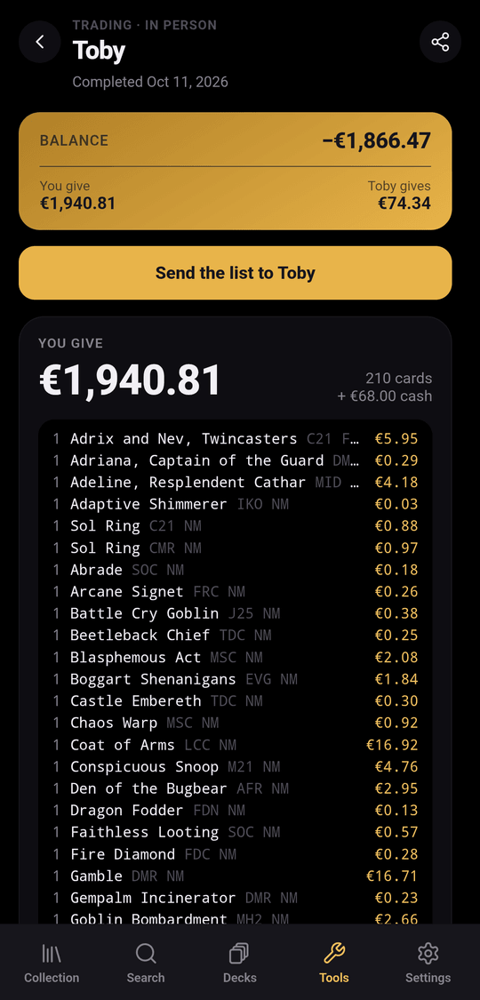

The trading wizard compares the value of both sides, then moves the cards in
and out of your collection in one step.

:::note
Trading is a tool you turn on: **Settings › Tools › Trading mode**. Turning it
on also makes your account findable as a trade partner by other users of the
server; accounts without it never appear in partner search.
:::

Open **Tools › Trading**. Trades are grouped into **Waiting for you** (marked
**Your turn**), **In progress** and **History**. Each row shows the partner,
how many cards each side gives, and the balance (**Even** or the difference).

## Start a trade

Tap **New trade** and choose who you trade with:

| Mode | When | What you enter |
|---|---|---|
| **In person** | At the table, with someone who may not use spellcache | Both sides. Their name is optional (e.g. "Sam at the LGS"). |
| **A user of spellcache** | Live, with another account of your server | Only your side. The other person picks their own cards on their device. |

For a live trade, search the other person's username (2 characters minimum).
Only users who turned on Trading mode can be picked.

## Pick what you give

**What do you give?** lists your cards grouped by container: the collection
itself, each binder and each deck. Search by name, filter with **All**,
**Binders** or **Decks**, open a group and tick cards, or use **Select all** to
add a whole binder.

A built deck can be traded whole (**Trade whole deck**), or dismantled first if
you only want to give some of its cards.

## Add what you get (in person)

**What does {partner} give?** has two tabs:

- **Search**: any card of the catalogue. Tap a result to choose another
  printing; **+** adds it as non-foil, NM, English, quantity 1. Adjust it later
  in **Details**.
- **Import a list**: paste a list or a CSV, or **Choose a file**. Accepted
  formats are listed in [Importing lists](../importing/). **Check the list**
  shows what was recognised, lets you pick a printing for ambiguous lines and
  lists what was not found; **Add N cards** confirms.

## Cash and notes

**Cash & notes** is optional (**Skip** in the header):

- **Cash**: in person, choose who pays whom and the amount. In a live trade,
  each side enters only what they pay. Cash counts at face value.
- **Notes**: what was discussed or promised, up to 2,000 characters.

## Review and compare

The summary shows a **Balance** band (**Even** or the difference) and one zone
per side with its total, its cards, and three buttons: **Add cards**, **Cash**
and **Details**.

- **Value at** applies a percentage to one side's cards: 80 %, 90 %, 100 %,
  110 %, or **Custom** (a percentage from 1 to 150, or a fixed amount). It never
  applies to cash.
- **Details** changes quantity, finish, condition, removes a card, or sets a
  **Unit price** instead of the market price.
- Cards without a price count as 0, and the summary says how many there are.

Prices come from your [price source](../collection/#prices-and-value). The
currency is fixed when the trade is created.

## Complete the trade

Choose where incoming cards go with **Cards you get go to**: the collection or
any binder.

**In person**: tap **Complete trade**. spellcache shows how many cards leave
and how many arrive, then applies the trade. An **Undo** button stays available
for a few seconds, except when a whole deck was traded, since the deck is
dismantled.

**Live**: both people tap **Accept trade**. Nothing changes until both accepted
the same version: if one side edits the trade after the other accepted, the
other has to review it again. You can **Withdraw acceptance** until then. Each
person only adds or removes their own cards; both can adjust prices and the
value percentage. The screen refreshes on its own while the trade is open.

**Cancel trade** keeps the trade in your history and changes nothing in your
collection.

:::note
Guests of a collection cannot trade from it (see [Sharing](../sharing/)).
:::

## Export a trade

**Export the trade** (share icon), or **Send the list to {partner}** once the
trade is completed, offers three formats:

| Format | Content |
|---|---|
| **Summary** | Both sides, cash and notes, readable by anyone |
| **Card list** | `qty Name (SET) number` lines, imported by Moxfield, Archidekt, Arena or spellcache |
| **CSV** | Every card with giver, set, number, finish, condition, language and price |

**Copy** puts it on the clipboard; **Share** opens the system share sheet, or
downloads a file where sharing is not available.
